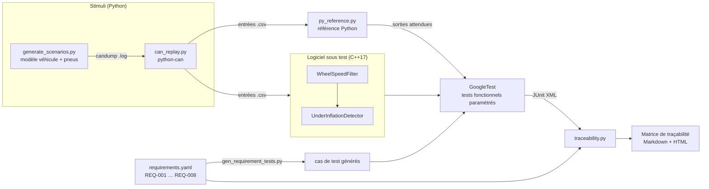

# TireTwin-QA

[](https://github.com/H-raf0/tiretwin-qa/actions/workflows/ci.yml)

**Banc de validation fonctionnelle automatisé d'un algorithme C++ de détection de sous-gonflage (iTPMS).**

Un petit algorithme embarqué en C++17 détecte un pneu sous-gonflé à partir des seules vitesses de roues lues sur un bus CAN, sans capteur de pression. Le vrai sujet du dépôt est la **chaîne de validation** construite autour : des exigences fonctionnelles écrites, des tests GoogleTest dérivés de ces exigences, une comparaison back-to-back avec une référence Python, un pipeline CI et une matrice de traçabilité exigence ↔ test ↔ résultat générée automatiquement.

*English summary [at the bottom](#english-summary).*

| | |
|---|---|
| Langages | C++17 (algorithme, tests), Python 3.10+ (outillage) |
| Tests | GoogleTest 1.15 (30 unitaires, 21 fonctionnels), pytest (35 tests d'outillage) |
| Build | CMake ≥ 3.21 + Ninja, GoogleTest via `FetchContent` ; GCC, MinGW et MSVC |
| CI | GitLab CI (`.gitlab-ci.yml`) et GitHub Actions (miroir) |
| Qualité | 8 exigences tracées, couverture `gcovr` 100 % lignes / 90 % branches sur l'algorithme, warnings traités en erreurs |

## Contexte

Un pneu sous-gonflé s'écrase davantage : son rayon de roulement diminue, donc il tourne **plus vite** que les autres à vitesse véhicule égale. Les systèmes iTPMS (*indirect Tyre Pressure Monitoring System*) exploitent cet effet avec les capteurs de vitesse de roue de l'ABS, déjà présents sur le véhicule. L'effet est faible (de l'ordre de 0,3 % de rayon pour 20 % de pression) et noyé dans des perturbations bien plus grandes (virages, freinages, différences d'usure entre pneus) : c'est un bon sujet de validation, parce que la difficulté n'est pas de détecter, mais de **ne pas se tromper**.

Projet personnel, réalisé sur données simulées. Il n'est lié à aucun constructeur ni manufacturier et ne prétend pas reproduire un produit existant.

## Architecture



```
tiretwin-qa/
├── algo/                        # le logiciel sous test : bibliothèque C++17 sans E/S ni dépendance
│   ├── include/tiretwin/        #   types.hpp, config.hpp, wheel_speed_filter.hpp, underinflation_detector.hpp
│   └── src/
├── cli/                         # tiretwin_cli : exécute l'algorithme sur un CSV (+ lecture/écriture CSV)
├── data/generate_scenarios.py   # simulateur : 9 scénarios de roulage → traces CAN candump
├── tools/
│   ├── can_codec.py             # définition des trames CAN (identifiants, facteurs d'échelle)
│   ├── can_replay.py            # rejeu d'une trace avec python-can → CSV d'entrée de l'algorithme
│   ├── py_reference.py          # implémentation de référence Python
│   ├── gen_requirement_tests.py # requirements.yaml → tables de cas de test C++
│   ├── build_dataset.py         # enchaîne génération, rejeu et référence (appelé par CMake)
│   └── traceability.py          # JUnit + requirements.yaml → matrice de traçabilité
├── tests/
│   ├── unit/                    # GoogleTest : une classe à la fois, entrées synthétiques
│   ├── functional/              # GoogleTest : un test paramétré par vérification d'exigence
│   └── python/                  # pytest : l'outillage est testé lui aussi
├── requirements.yaml            # les exigences fonctionnelles (source unique de vérité)
├── .gitlab-ci.yml               # pipeline GitLab
├── .github/workflows/ci.yml     # miroir GitHub Actions (+ build Windows/MSVC)
└── docs/traceability.md         # exemple de matrice générée (+ version HTML)
```

## L'algorithme

Entrées à 50 Hz : vitesses des quatre roues, vitesse véhicule, angle volant, état du frein, demande de réinitialisation, âge des signaux.

1. **Conditionnement** (`WheelSpeedFilter`) : surveillance de la fraîcheur des signaux (timeout CAN de 200 ms, valeurs non finies), filtre passe-bas, et rejet des phases non représentatives : vitesse < 20 km/h, angle volant > 10°, freinage, plus 1 s de stabilisation après chacune.
2. **Indicateur** (`UnderInflationDetector`) : pour chaque essieu, écart relatif gauche/droite `d = (ωg − ωd) / (ωg + ωd)`, corrigé de l'effet géométrique des courbes douces calculé à partir de l'angle volant. Comparer deux roues du même essieu annule la vitesse véhicule et le glissement moteur, communs aux deux.
3. **Calibration** : les 30 premières secondes de roulage exploitable servent à apprendre l'écart naturel entre les pneus (usure, tolérances), retranché ensuite.
4. **Décision** : moyenne glissante sur 10 s ; alerte sur une roue si l'écart dépasse 0,10 % pendant 10 s. L'alerte est mémorisée jusqu'à la réinitialisation.

Sorties : état (`Unavailable`, `Calibrating`, `Monitoring`, `Warning`), masque des roues en alerte, écart filtré de chaque roue en %.

## Exigences

| ID | Exigence (résumé) | Vérification |
|---|---|---|
| REQ-001 | Détecter une perte ≥ 20 % sur une roue, en la désignant, en moins de 120 s | 4 scénarios, un par roue |
| REQ-002 | Aucune fausse alerte sur 30 min de roulage nominal | scénario mixte de 30 min |
| REQ-003 | Aucune alerte due à un virage serré ou à un freinage, même prolongés | virages de 40 s, freinage de 30 s |
| REQ-004 | Trames CAN absentes > 200 ms : état « indisponible », pas de plantage, reprise | silence bus de 3 s + une trame perdue |
| REQ-005 | Sorties C++ identiques à la référence Python (tolérance 1e-6) | back-to-back sur les 9 scénarios |
| REQ-006 | Temps de calcul < 1 ms par pas | mesure sur 90 000 pas |
| REQ-007 | Détecter quatre pneus sous-gonflés de façon égale | **limitation connue**, test « échec attendu » |
| REQ-008 | Réinitialisation après changement de pneu | changement de pneu + appui reset |

Le texte complet est dans [requirements.yaml](requirements.yaml). Chaque entrée `verification` de ce fichier devient un test GoogleTest à la compilation : ajouter une vérification ajoute un test, sans toucher au C++.

## Construire et lancer

Prérequis : CMake ≥ 3.21, Ninja, un compilateur C++17 (GCC, Clang, MinGW ou MSVC), Python ≥ 3.10. GoogleTest est téléchargé par CMake.

```bash
python -m venv .venv
source .venv/Scripts/activate          # Linux/macOS : source .venv/bin/activate
pip install -r requirements-dev.txt

cmake --preset release                 # configure (Ninja, Release)
cmake --build --preset release         # compile, génère les scénarios CAN et les cas de test
ctest --preset release                 # tests GoogleTest → build/reports/*.xml
python -m pytest                       # tests de l'outillage Python
```

Avec Visual Studio à la place de Ninja : `cmake -S . -B build`, `cmake --build build --config Release`, `ctest --test-dir build -C Release`.

Matrice de traçabilité et couverture :

```bash
python tools/traceability.py --requirements requirements.yaml --junit "build/reports/*.xml" \
    --md reports/traceability.md --html reports/traceability.html --strict

cmake --preset coverage && cmake --build --preset coverage      # GCC/Clang/MinGW
ctest --preset coverage
cmake --build --preset coverage --target coverage               # rapport dans build-coverage/coverage/
```

La chaîne peut aussi se dérouler à la main, étape par étape :

```console
$ python data/generate_scenarios.py --out demo --only loss20_fl
loss20_fl.log: 24000 frames
$ sed -n '4001,4002p' demo/loss20_fl.log
(1700000040.000000) vcan0 100#CB3DD53DD83DCB3D
(1700000040.001000) vcan0 101#1D23FDFF00
$ python tools/can_replay.py demo/loss20_fl.log demo/loss20_fl.csv
demo/loss20_fl.csv: 12000 samples
$ ./build/cli/tiretwin_cli demo/loss20_fl.csv demo/out.csv
12000 samples processed, final warning mask: 0x1 (FL=1 FR=2 RL=4 RR=8)
```

## Résultats

Sortie de `ctest` puis des deux exécutables de test (Windows 11, MinGW GCC 13.2) :

```
1/2 Test #1: unit_tests .......................   Passed    0.12 sec
2/2 Test #2: functional_tests .................   Passed    1.54 sec
100% tests passed, 0 tests failed out of 2

[==========] 30 tests from 4 test suites ran. (2 ms total)
[  PASSED  ] 30 tests.
[==========] 21 tests from 8 test suites ran. (1464 ms total)
[  PASSED  ] 20 tests.
[  SKIPPED ] 1 test.        <- REQ-007, échec attendu
```

### Matrice de traçabilité

Synthèse produite par `tools/traceability.py` (la version complète, avec le détail test par test et les mesures, est dans [docs/traceability.md](docs/traceability.md) ; la CI la publie aussi en HTML) :

| Exigence | Intitulé | Tests | Verdict |
|---|---|---|---|
| REQ-001 | Détection d'une perte de pression | 4/4 | ✅ Réussi |
| REQ-002 | Absence de fausse alerte en roulage nominal | 1/1 | ✅ Réussi |
| REQ-003 | Robustesse aux virages serrés et aux freinages | 1/1 | ✅ Réussi |
| REQ-004 | Perte de communication CAN | 1/1 | ✅ Réussi |
| REQ-005 | Équivalence avec l'implémentation de référence | 9/9 | ✅ Réussi |
| REQ-006 | Budget de temps de calcul | 1/1 | ✅ Réussi |
| REQ-007 | Sous-gonflage simultané des quatre pneus | 0/1 | ⚠️ Limitation connue |
| REQ-008 | Recalibration après changement de pneu | 1/1 | ✅ Réussi |

Quelques mesures relevées par les tests : détection d'une perte de 20 % en 14 s environ après son établissement ; écart C++/Python nul au bit près sur les 9 scénarios ; pas de calcul de l'ordre de 50 ns en moyenne sur PC.

Avec `--strict`, l'outil sert de barrière qualité : il sort en erreur si une exigence n'a pas de test, si un test lié échoue, si un test pointe vers une exigence inexistante, ou si le statut déclaré d'une exigence contredit les résultats (par exemple une « limitation connue » dont le test se met à passer).

### Ce que la chaîne a attrapé pendant le développement

- **Back-to-back** : le test REQ-005 sur le scénario de changement de pneu a révélé que `reset()` remettait à zéro la somme de la fenêtre glissante mais pas son contenu. Les tests unitaires d'alors passaient. Corrigé, avec un test de non-régression.
- **Couverture** : le rapport `gcovr` a montré une méthode jamais appelée (`WheelSpeedFilter::reset`), supprimée.
- **Tests de sensibilité** : deux tests retirent une protection de l'algorithme (rejet des virages, réinitialisation) et vérifient que le scénario correspondant produit alors bien une fausse alerte. Un scénario qui ne peut pas échouer ne prouve rien.

## Intégration continue

`.gitlab-ci.yml` définit quatre étapes :

| Étape | Job | Rôle |
|---|---|---|
| build | `build` | compilation, génération des scénarios et des cas de test |
| test | `test` | GoogleTest + pytest, rapports JUnit affichés dans GitLab |
| test | `coverage` | build instrumenté, rapport `gcovr` (Cobertura + HTML), seuil de 90 % de lignes |
| report | `traceability` | matrice de traçabilité, échec en cas d'écart |
| release | `package`, `pages` | livrable accompagné de ses preuves de validation ; publication de la matrice et de la couverture |

`.github/workflows/ci.yml` exécute les mêmes commandes sur GitHub (Linux/GCC), affiche la matrice dans le résumé du job, et ajoute un build Windows/MSVC.

## Interface CAN simulée

Deux trames périodiques de 20 ms, signaux little-endian :

| ID | Trame | Contenu |
|---|---|---|
| `0x100` | `WHEEL_SPEEDS` (8 octets) | 4 × `uint16`, 0,005 rad/s par bit, ordre AVG, AVD, ARG, ARD |
| `0x101` | `VEHICLE_STATE` (5 octets) | vitesse `uint16` 0,01 km/h ; angle volant `int16` 0,1° (positif à gauche) ; drapeaux : bit 0 frein, bit 1 demande de réinitialisation |

Les traces sont au format texte de `candump -l` (can-utils) et relues avec `python-can`. Elles sont déterministes (graine fixe) et donc régénérées à la compilation plutôt que versionnées (43 Mo).

## Limites connues

- **Données simulées.** Le modèle véhicule est cinématique et les seuils sont réglés sur cette simulation, pas sur des roulages réels. La sensibilité retenue (20 % de pression ↔ 0,3 % de rayon) est un ordre de grandeur.
- **Méthode purement relative.** Une perte identique sur les quatre roues (REQ-007) ou sur les deux roues d'un même essieu n'est pas détectée. Les systèmes industriels ajoutent une analyse fréquentielle des vitesses de roues pour cela.
- **Calibration aveugle.** Une réinitialisation faite avec un pneu déjà sous-gonflé apprend le défaut comme référence. Un pneu sur-gonflé fait désigner son voisin.
- **Compensations absentes.** Pas de correction de charge, de vitesse ou de température ; pas de vitesse de lacet ; la correction des courbes suppose une géométrie nominale ; les fortes accélérations ne sont pas rejetées.
- **Pas de mémoire non volatile** : la calibration et l'alerte sont perdues à la coupure du contact.
- **Temps de calcul** (REQ-006) mesuré sur PC : cela borne un ordre de grandeur, pas un pire cas sur cible embarquée.
- **CAN simplifié** : messagerie inventée, sans fichier DBC, sans compteur ni somme de contrôle de bout en bout.
- **ASPICE** : le dépôt illustre le principe de traçabilité exigence ↔ test ↔ résultat des processus de vérification logicielle. Ce n'est pas un processus conforme (pas de revues, de stratégie de test formalisée ni de lien vers des exigences système).
- **Couverture** : lignes et branches, pas de MC/DC.
- **Pipeline GitLab** : il n'a pas encore tourné sur un runner GitLab ; ce sont les mêmes commandes, exécutées par le miroir GitHub Actions, qui sont vérifiées.

## English summary

TireTwin-QA is an automated functional validation bench for a small C++17 embedded algorithm that detects an under-inflated tyre from wheel speeds only (indirect TPMS, radius analysis), read from a simulated CAN bus.

- **Software under test**: a dependency-free C++17 library (`WheelSpeedFilter`, `UnderInflationDetector`) with a Python reference implementation.
- **Stimuli**: a deterministic driving simulator writes CAN traces in `candump` format; `python-can` replays them into the algorithm's input tables.
- **Requirement-based testing**: eight functional requirements live in `requirements.yaml`; each verification entry is turned into a parameterised GoogleTest case at build time. Back-to-back tests compare C++ and Python outputs on every scenario.
- **Evidence**: GitLab CI and GitHub Actions build, test, measure coverage with `gcovr` (100 % lines, 90 % branches on the algorithm) and generate an ASPICE-style traceability matrix (requirement ↔ test ↔ result) that fails the pipeline on any gap.

Build and run: `pip install -r requirements-dev.txt`, `cmake --preset release`, `cmake --build --preset release`, `ctest --preset release`. All data is simulated; see *Limites connues* for what the project does not claim.

## Licence

[MIT](LICENSE)
